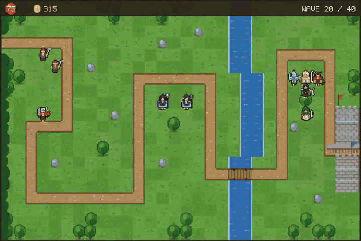
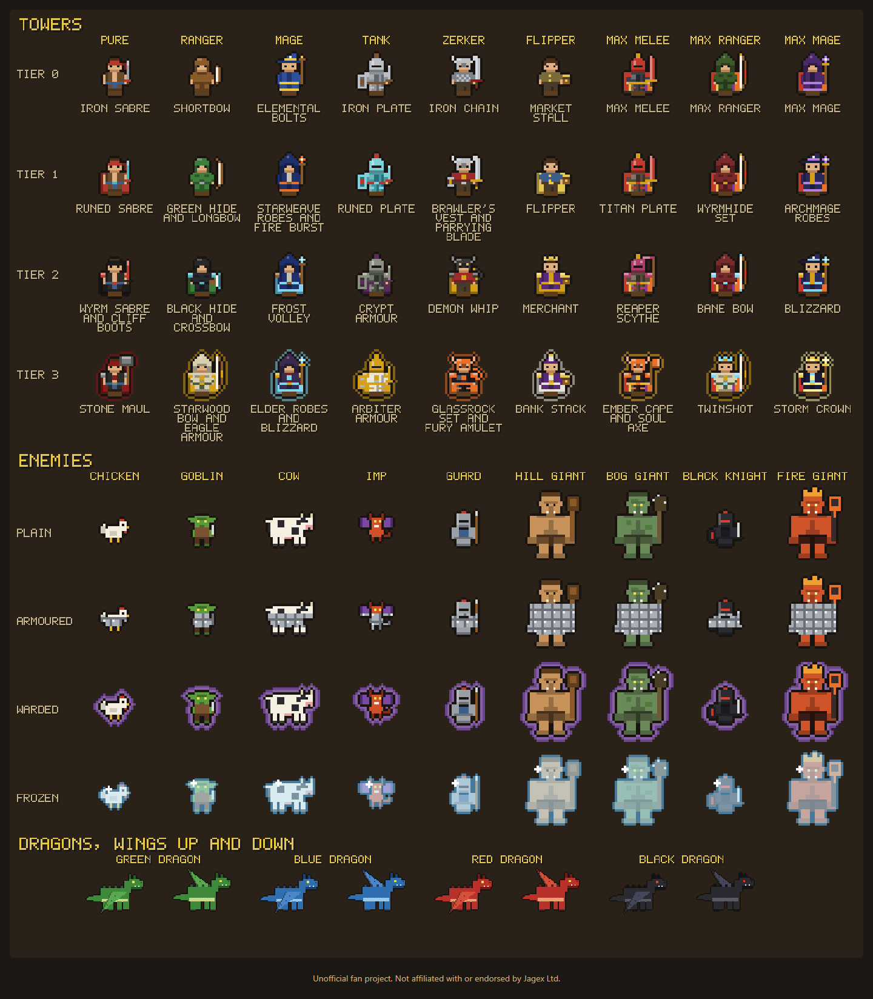
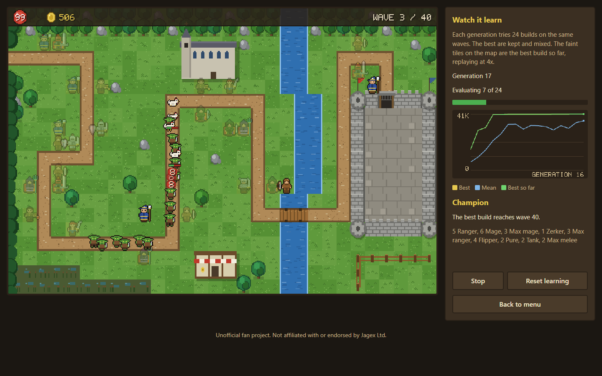
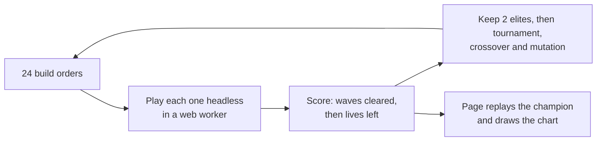

<div align="center">

# Maxed Out

**A tower defence game for the browser, built around the account builds of Old School RuneScape.**



**[Play it in your browser](https://jatzo.github.io/Maxed-Out/)** · [Run it locally](#play-it) · [The towers](#the-towers) · [Watch it learn](#watch-it-learn) · [How it is built](#how-it-is-built)

</div>

> **Unofficial fan project.** Maxed Out is a non-commercial fan project inspired by Old School RuneScape. It is not affiliated with or endorsed by Jagex Ltd, which owns the Old School RuneScape trade mark. It uses no Jagex art, music, logos, item names or place names. The sprites, gear names and map are original and drawn in code.

Build a level 70 pure, a ranger, a mage, a tank, a zerker, a flipper and three maxed accounts along a path to the castle gate, and hold off 40 waves of chickens, goblins, giants, armoured knights and a dragon every tenth wave. Each tower has four tiers of gear, and every upgrade changes its outfit and its weapon. If you would rather watch, a genetic algorithm plays instead and gets better while you look.

## Play it

The quickest way is in your browser at [jatzo.github.io/Maxed-Out](https://jatzo.github.io/Maxed-Out/). To run it locally you need Node.js 22 or later, and there is nothing to install.

```
npm start
```

Then open http://localhost:5173. The page has to come from a server because browsers block module scripts and workers on `file://`. If you would rather not use Node, `python -m http.server 5173 --bind 127.0.0.1` from the project folder works too.

Pick a tower from the shop (keys 1 to 9) and click a grass tile to place it. Click a tower to upgrade it, sell it for 70% of what it cost, or change what it targets. Space starts the next wave, and the game runs at one, two or four times speed. Clear wave 40 to win, then keep going in freeplay if you like.

## The towers

| Tower | Cost | Good at | Weak against |
|---|---|---|---|
| Pure | 150 | Cheap early damage | Armour |
| Ranger | 300 | Reach; later shots pierce a line | Heavy armour |
| Mage | 400 | Ignores armour; freezes from tier 2 | Warded enemies |
| Tank | 350 | Slows everything nearby, later breaks armour | Doing damage |
| Zerker | 600 | Big hits through armour | Short reach |
| Flipper | 500 | 60 to 400 gold at the end of each wave | Everything, it does not fight |
| Max melee, ranger, mage | 3,000 each | The late waves and the dragons | Your gold |

Physical damage loses the target's armour from every hit, down to a minimum of 1. Magic ignores armour, but warded enemies take none of it and cannot be frozen. Slows do not stack, and bosses shrug off half of a slow and most of a freeze. All of the numbers live in [`src/core/data.js`](src/core/data.js).



## Watch it learn

Choose "Watch it learn" on the title screen and a genetic algorithm starts playing. Each generation tries 24 build orders on the same waves, keeps the best two unchanged, and breeds the rest from tournament winners. The map replays the best build so far at four times speed, with its planned tiles drawn faintly, while the chart tracks the best, mean and best-so-far scores. Progress is kept between visits.





A build order is a list of 40 genes, each a tower type and a tile. On an empty tile a gene places that tower; on an occupied one it upgrades whatever stands there. Starting from random orders, the population's median build goes from losing on wave 4 or 5 to clearing 37 to 40 waves within 15 generations, on each of three seeds.

## How it is built

- **A deterministic simulation.** The game runs in fixed steps of 1/30 of a second with a seeded random number generator, so a seed and a build order always play out the same way. The browser, the tests and the genetic algorithm all run the same code. See `createGame` in [`src/core/sim.js`](src/core/sim.js).
- **Targeting without a distance check per enemy.** Each tower works out once which stretches of the path its range covers. Enemies are kept in order of how far they have walked, so finding targets is a binary search. A full 40-wave game takes about 0.4 seconds headless. See `refreshWindows` and `enemiesInRange` in [`src/core/sim.js`](src/core/sim.js).
- **Balance checked by bots.** [`scripts/balance.mjs`](scripts/balance.mjs) plays fixed strategies against the real simulation and fails if any target is missed. Building nothing loses by wave 5. Cheap pures alone die by wave 11, and mages alone by wave 18, because armour and warded enemies each counter one of them. A hand-written mixed build clears all 40 waves on five seeds and kills all 20 dragons.
- **Pixel art drawn in code.** Sprites are small grids of palette colours. Each tower is one body with layered legs, body, cape, head and weapon pieces, tinted per tier, so 36 outfits and 26 weapon drawings come from small reusable pieces. Composed sprites are cached on offscreen canvases. See `buildTower` and `WEAPONS` in [`src/render/sprites.js`](src/render/sprites.js).
- **One state contract between two halves.** The simulation and the renderer only meet through the shapes in [`src/core/contract.js`](src/core/contract.js). A test runs a real game to the middle of a wave and checks it has exactly the fields the renderer was built against.
- **No dependencies.** Plain HTML, ES modules and Canvas 2D, a small static server and Node's built-in test runner.

There are 77 tests. `npm test` first runs [`scripts/check.mjs`](scripts/check.mjs), which checks every file's syntax and the house style.

```
npm test
node scripts/balance.mjs
node scripts/balance.mjs --ga
```

## Licence

The code and the original art in this repository are under the [MIT licence](LICENSE). That covers nothing belonging to Jagex Ltd.
